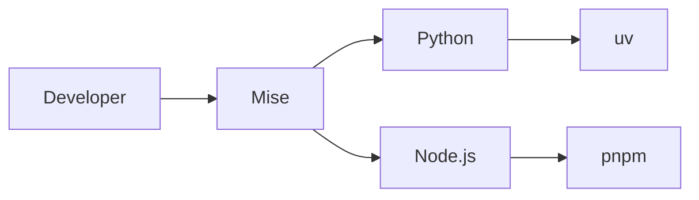
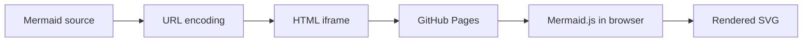

# Mermaid Renderer

A lightweight, browser-based Mermaid renderer that turns diagrams-as-code into embeddable HTML iframes.

Designed for Hashnode, technical blogs and documentation platforms where native Mermaid rendering is unavailable or custom JavaScript is restricted.

**No backend. No database. No build step. Just a static website.**

## Features

- Render Mermaid diagrams directly in the browser.
- Preview diagrams and generate copyable iframe HTML.
- Store the diagram source in the URL, without uploading images or storing diagrams on a server.
- Support Mermaid's `neutral`, `default`, `dark` and `forest` themes.
- Deploy directly to GitHub Pages using vanilla HTML, CSS and JavaScript.

## Quick start

Once deployed, open the renderer:

```text
https://cenzwong.github.io/mermaid-renderer/
```

1. Paste your Mermaid source into the editor.
2. Click **Generate Embed** to render the diagram and generate the iframe HTML.
3. Click **Copy HTML**.
4. Paste the iframe into your blog or documentation platform.

### Example



The renderer generates an iframe similar to this working-format minimal example (replace the host if you deploy elsewhere):

```html
<iframe
  src="https://cenzwong.github.io/mermaid-renderer/?code=flowchart%20LR%0A%20%20A%5BStart%5D%20--%3E%20B%5BFinish%5D&amp;theme=neutral"
  width="100%"
  height="400"
  style="border:0"
  loading="lazy"
  title="Mermaid diagram">
</iframe>
```

## Using with Hashnode

1. Open the Hashnode article editor.
2. Type `/html` and select **Insert HTML**.
3. Paste the generated iframe HTML, not a fenced code block.
4. Click **Preview** and check the published article as well.

This approach avoids running custom JavaScript inside Hashnode. Mermaid executes on the renderer's own page instead. The publishing platform must permit iframes from the renderer's origin.

## URL interface

The renderer supports two modes:

| Mode | URL | Behaviour |
| --- | --- | --- |
| Editor | `/` | Show the editor, preview and embed generator. |
| Embed | `/?code=...` | Render only the supplied diagram. |

| Parameter | Required | Description |
| --- | --- | --- |
| `code` | For embed mode | URL-encoded Mermaid source. |
| `theme` | No | `neutral` (default), `default`, `dark` or `forest`. |

Example:

```text
?code=flowchart%20LR%0AA%5BStart%5D%20--%3E%20B%5BFinish%5D&theme=neutral
```

To construct a URL programmatically:

```javascript
const url = new URL('https://cenzwong.github.io/mermaid-renderer/');
url.searchParams.set('code', 'flowchart LR\nA[Start] --> B[Finish]');
url.searchParams.set('theme', 'neutral');
console.log(url.href);
```

## Architecture



The URL carries the application state. GitHub Pages distributes the application, while the browser performs the rendering. No server-side rendering or database is required. This follows a stateless, browser-first architecture.

## Project structure

```text
mermaid-renderer/
├── index.html    # Editor, embed generator and renderer
├── .nojekyll     # Bypass Jekyll for branch-based GitHub Pages deployment
└── README.md
```

## Local development

```bash
git clone https://github.com/cenzwong/mermaid-renderer.git
cd mermaid-renderer
python3 -m http.server 8000
```

Open [http://localhost:8000](http://localhost:8000). No package installation or build command is required. An internet connection is needed to load Mermaid.js from the CDN.

## Deployment

1. Push `index.html`, `.nojekyll` and `README.md` to the `main` branch.
2. Open the repository's **Settings → Pages**.
3. Select **Deploy from a branch**.
4. Choose `main` and `/ (root)`, then save.
5. Open the GitHub Pages URL after deployment completes.

For a fork or differently named repository, use its own Pages URL when generating embeds.

## Limitations and security

- Long diagrams may exceed URL length limits imposed by browsers or publishing platforms.
- The iframe height is fixed by its HTML attribute; adjust it for larger diagrams.
- Mermaid.js is loaded from a third-party CDN. Pin an exact version or self-host it for reproducible deployments.
- Diagram source is visible in the URL and may appear in browser history or server logs. Do not include secrets or confidential data.
- Mermaid is configured with `securityLevel: 'strict'`; this is not a substitute for keeping the dependency updated or reviewing untrusted input.
- Embedding depends on the publishing platform's iframe policy. Check both preview and published output.

## Roadmap

- [ ] Adjustable iframe height and theme selector in the editor.
- [ ] Compressed URLs for larger diagrams.
- [ ] SVG and PNG export.
- [ ] Optional self-hosted rendering dependencies.
- [ ] Additional browser-compatible diagram engines, such as Graphviz.

## References

- [Mermaid](https://mermaid.js.org/)
- [GitHub Pages](https://pages.github.com/)
- [Hashnode](https://hashnode.com/)
